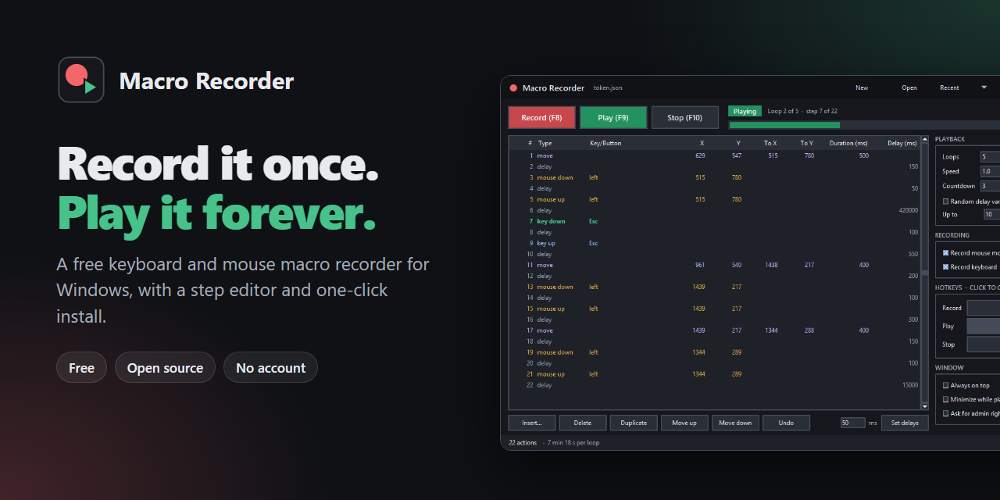
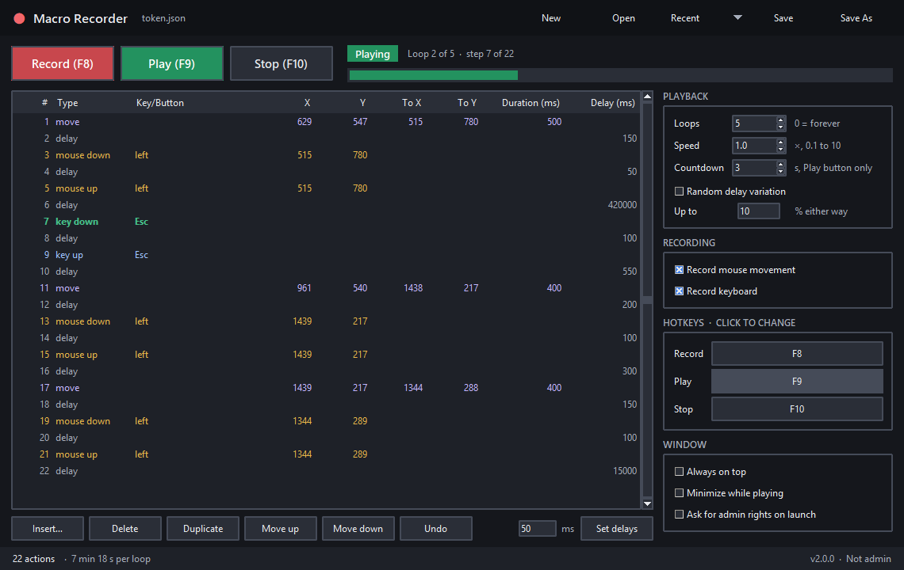

<p align="center"></p>

<h1 align="center">Macro Recorder</h1>

<p align="center">
  <b>A free keyboard and mouse macro recorder for Windows, with a step-by-step editor.</b><br>
  <a href="https://github.com/fwsoapy/macro-recorder/releases/latest/download/MacroRecorderSetup.exe"><b>Download the installer</b></a>
  &nbsp;·&nbsp;
  <a href="https://github.com/fwsoapy/macro-recorder/releases/latest">All downloads</a>
</p>

Press F8, do the thing you want repeated, press F8 again. Every key press, click, mouse movement
and pause lands in a table you can edit, and F9 plays it back as many times as you like.

## Install

1. Download **[MacroRecorderSetup.exe](https://github.com/fwsoapy/macro-recorder/releases/latest/download/MacroRecorderSetup.exe)**.
2. Double-click it. It installs and opens Macro Recorder. There are no pages to click through,
   and no admin prompt, because it installs just for you.

It adds a Start menu and desktop shortcut. To remove it, use **Settings → Apps → Installed apps**.

Want no install at all? Download `MacroRecorder-portable.exe` from the
[releases page](https://github.com/fwsoapy/macro-recorder/releases/latest) and run it from anywhere.
Put a `config.json` next to it and it keeps its settings there, so it works from a USB stick.

**Windows SmartScreen** may say it "protected your PC", because the app is new and not code-signed.
Press **More info → Run anyway**. The full source is here if you'd rather build it yourself.

## Use it



| Key | What it does |
|---|---|
| **F8** | Start or finish recording |
| **F9** | Play |
| **F10** | Stop |

The hotkeys work while your game or any other window is in front. Click one in the **Hotkeys**
box to change it.

**Playing from the window** counts down 3 seconds first, so you can click Play and switch to your
game. Pressing F9 inside the game starts straight away. Change the countdown in **Playback**.

While a macro plays, the bar at the top shows the loop and step, and the step being played is
highlighted green in the table.

### Editing

- Double-click a cell to change it. Type and button cells open a menu.
- Right-click a row and pick **Add above** or **Add below** to add a key press, key down or up,
  mouse click, mouse down or up, mouse move or delay. Right-click empty space to add at the end.
- Select several rows with Ctrl or Shift, then use the buttons under the table.
- **Set delays** changes every selected delay row at once.

Shortcuts: **Delete** removes rows, **Ctrl+Z** undoes, **Ctrl+D** duplicates, **Ctrl+A** selects
all, **Ctrl+S** saves, **Ctrl+O** opens, **Ctrl+N** starts a new macro. **Recent** in the top bar
reopens your last eight macros.

### Delays

Each pause is its own row, so you can add, move, duplicate or delete one without touching the
actions around it. A recording puts a delay row in each gap between actions.

### Mouse moves

Each stretch of mouse movement is one row, from X, Y to To X, To Y over Duration. The row keeps
the exact path you drew, so playback follows your curve. Edit the start, end or duration and the
path bends and stretches to fit. A move you add yourself goes in a straight line, and a duration
of 0 jumps straight there.

### Playback options

- **Loops:** how many times to play. 0 repeats until you press Stop.
- **Speed:** 2.0 plays twice as fast. Your saved delays don't change.
- **Countdown:** seconds to wait when you press the Play button.
- **Random delay variation:** changes each delay by up to the percent you set, either way, so
  playback isn't perfectly regular.
- **Always on top**, **Minimize while playing** and **Ask for admin rights on launch** are under
  **Window**.

### Key names

In the Key/Button column use names like `A`, `5`, `F1`, `Space`, `Enter`, `Esc`, `Tab`, `LShift`,
`RCtrl`, `LAlt`, `Left`, `PageUp`, `Num0`, `NumEnter`. For any other key, use its hex virtual key
code, such as `VK_B3`.

## Limits

- **First-person camera control:** moves are absolute cursor positions. Games that turn the
  camera from raw mouse input may ignore them. Keys and clicks still work there.
- **Games running as admin:** Windows stops a normal app from seeing keys in, or sending input to,
  an elevated window. Tick **Ask for admin rights on launch** if hotkeys or playback do nothing.
- **Anti-cheat:** some games block injected input or ban macro use. Check your game's rules before
  using this online.
- **Held keys:** a held key is recorded as one key down, without Windows auto-repeat. Games see it
  as held; a text box types one character.
- **Not recorded:** the scroll wheel and the side mouse buttons.
- **Screen layout:** X and Y are physical pixels, so mouse macros need the resolution and monitor
  layout they were recorded on.

Playback always releases any key or button the macro still holds when it stops.

## Macro files

Macros are plain JSON, one action per line, so they are easy to share or edit by hand. They are
saved to `Documents\Macro Recorder` unless you pick another folder.

```json
{
  "version": 1,
  "actions": [
    {"type": "key down", "key": "W", "vk": 87, "scan": 17, "ext": false},
    {"type": "delay", "delay_ms": 20.0},
    {"type": "move", "x": 640, "y": 360, "to_x": 652, "to_y": 368, "duration_ms": 16.6, "path": [[640, 360, 0.0], [646, 364, 8.3], [652, 368, 16.6]]},
    {"type": "mouse down", "key": "left", "x": 652, "y": 368}
  ]
}
```

If you change `key` by hand, the app works out the new codes when it loads the file. Settings are
stored in `%APPDATA%\MacroRecorder-fwsoapy\config.json`.

## Run from source

Python 3.10 or newer on Windows, with tkinter (the python.org installer includes it). No other
dependencies.

```bash
python app.py
```

Tests:

```bash
python -m unittest tests.test_macro tests.test_app
```

`test_app.py` opens the real window for a few seconds. `tests/test_live_input.py` sends real input
and moves your cursor briefly, so leave the keyboard and mouse alone while it runs.

## Build the installer

Needs `pip install pyinstaller pillow` and [Inno Setup 6](https://jrsoftware.org/isdl.php).

```bash
python build.py
```

That writes `release\MacroRecorderSetup.exe` and `release\MacroRecorder-portable.exe`.

```
app.py          the window
engine.py       keyboard and mouse hooks, SendInput playback
macro.py        actions, editing, file format, settings
installer.iss   the one-click installer
build.py        builds the exe files and the installer
assets/         icon and README images
```

## License

[MIT](LICENSE)
